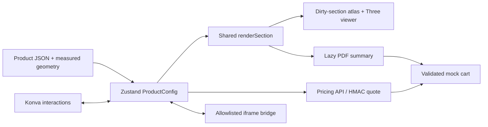

# Canopy configurator

## Overview

Reusable React 18 + TypeScript product configurator: edit eight printable sections in 2D, preview a real tent in 3D, request signed prices, generate a production summary, and add to a mock Shopify cart. Live demo: **deployment URL pending**. Source assets are confidential and remain outside Git.

## Architecture



`src/core` owns product-independent schemas, validation, history, rendering and contracts. Features consume those contracts; service adapters and a single dependency-injection point isolate transport/storage. `server` contains pricing rules and Web-standard handlers shared by Vite and Vercel functions. MSW is reserved for tests.

## Config data model

One versioned, serializable `ProductConfig` holds product/variant IDs, quantity, option selections, section backgrounds and ordered text/image elements. Positions and sizes are normalized. Asset metadata lives in JSON; normalized blobs live in IndexedDB. The product definition supplies sizes, material bindings, per-size UV geometry, fonts and constraints. Load validates schemas and product constraints; migrations are explicit. Undo/redo records whole transactions.

## How to add a new product

1. Add a definition JSON and loader under `src/products/<id>`; register it in the application and backend product registry.
2. Optimize its GLB into `public/models`; preserve material/node bindings.
3. Measure each printable section's UV rectangle, rotation, clipped shape and real dimensions per variant.
4. Add server pricing rule data and Shopify variant references. Add geometry, validation and quote tests.

## 2D/3D sync

Both views subscribe to one store. Konva draws interaction handles over a canvas produced by `renderSection`; the atlas and PDF call that same renderer. Dirty section identity changes trigger cached section rendering and clipped atlas compositing, coalesced per animation frame. Debug and selection overlays are separate from artwork/captures. Open `/?debug=atlas` to verify orientation on each size.

## Pricing and quote signing flow

The UI sends config to `/api/price` and displays the returned quote; it contains no price arithmetic. Server-side JSON rules define base, customization, options and quantity discounts. Debounced requests retain the previous total, cancel obsolete requests and cache quotes. Movement alone does not reprice. Checkout always requests a fresh quote for the exact full config hash. HMAC claims bind quote ID, hash, currency, total and expiry; `/api/cart` verifies the signature, expiry and recomputed price. Tax is deferred to Shopify. See [API contracts](docs/api.md).

## Shopify integration and production notes

`mapToCartLine` produces Ajax `/cart/add.js` and Storefront `cartLinesAdd` line inputs. Hidden `_` properties reference the config, signed quote and PDF; visible properties describe size, frame, printing and production speed. The receipt panel exposes both mapped payload and mock response.

Storefront properties **cannot set custom prices**. Production needs a Shopify Function/cart transform or draft-order integration, real variant IDs, durable configuration storage, and an accessible PDF upload service. `_configuration` currently references the config hash; a real backend must persist and resolve that reference. The mock endpoint validates the full submitted config. Do not send a blob URL to a real production workflow.

## PDF

Download or checkout lazily generates `order-<configHash8>.pdf`: five clean 3D views, eight section previews with physical dimensions, text/fonts/colors/image DPI and safe/bleed notes, and a price/options summary. The PDF Subject metadata stores `ProductConfigBase64:<base64 UTF-8 JSON>` instead of an attachment. Section previews are 150 DPI at their size on the PDF page, **not full-scale print masters**. `PdfStore` is swappable; the local mock persists blobs in IndexedDB and returns session-local blob URLs. Progress and retry are visible.

## Embedding

Use `<iframe src="https://YOUR-APP/?embed=1" title="Tent configurator"></iframe>`. [embed-demo.html](public/embed-demo.html) provides a working host, message log, controls and a Shopify theme listener example. Fonts, models and Draco are served locally.

Every message has `{source:'canopy-configurator', version:1, type, payload}`. Receivers check the actual parent window, exact origin and a strict schema. Set `VITE_ALLOWED_PARENT_ORIGINS` to comma-separated HTTPS origins; an explicitly configured `*` also allows any parent origin for this public demo. Production defaults to rejecting parent messages.

| Direction | Types                      | Payload                                             |
| --------- | -------------------------- | --------------------------------------------------- |
| Out       | ready                      | productId                                           |
| Out       | resize                     | height                                              |
| Out       | config-changed             | config, configHash, total (null while updating)     |
| Out       | add-to-cart                | cartLine (Ajax), storefront, quote, pdfRef, receipt |
| Out       | error                      | code, message                                       |
| In        | load-config                | config                                              |
| In        | set-variant / set-quantity | variantId / quantity                                |
| In        | request-config             | empty object                                        |
| In        | set-theme                  | variables: approved CSS color variables             |

Theme variables: `--color-background`, `--color-surface`, `--color-text`, `--color-muted`, `--color-border`, `--color-accent`; hex colors only. The demo shows origin/source checks that the host must also enforce.

Vercel static headers cannot interpolate environment variables. **Before deployment**, run `VITE_ALLOWED_PARENT_ORIGINS=https://your-store.myshopify.com pnpm prepare:deploy` locally; this writes the exact `frame-ancestors` allowlist to `vercel.json`. Set the same variable in Vercel for the bridge. Default CSP allows same-origin framing. No DENY frame header is set. Models, fonts and Draco have immutable caching: rename assets when replacing them.

## Performance

Original models around 10 MB were reduced to roughly 0.3 MB each using Draco, deduplication and WebP textures. Viewer, editor and PDF code are lazy chunks. Demand rendering, capped DPR, cached section canvases, RAF coalescing and debounced pricing reduce idle work. PDF generation targets three seconds on a warm desktop; actual time depends on device, fonts and model loading. The local software-rendered Chrome smoke test completed cold checkout (quote, captures, PDF and cart) in 9.3 seconds; the three-second target is not yet verified on hardware rendering.

## Key decisions and trade-offs

Product data stays outside the generic engine. Material names resolve primitives because their order differs per GLB. UVs use top-origin glTF image coordinates with `flipY=false`; per-section rotation and clipping preserve roof orientation. Models normalize bounding-box width to real physical dimensions. Local assets avoid CDN/CSP dependencies. Browser PDF generation and mock adapters keep this technical test self-contained.

## Known limitations

- Original uploads are discarded after normalization/downscaling to 2048 pixels; IndexedDB is browser-local and not a production archive.
- PDF blob URLs are session-local; configuration references and PDF files need durable shared storage before real fulfillment.
- Idempotency is process-local; serverless instances/restarts need shared durable storage in production.
- Cart, checkout URL and Shopify variant IDs are mocks. Pricing rules are illustrative, USD only; tax is excluded.
- The 6.5×6.5 GLB mesh is mis-scaled and normalized by the viewer. Safe-margin/bleed values remain unverified defaults.
- PDF metadata preserves Unicode config; jsPDF's built-in report text font has limited Unicode support. Artwork uses the bundled fonts.
- Mobile PDF capture warms the viewer offscreen; cold loads and slower devices may exceed the generation target.

## Running locally and env vars

Node >=22.12 and pnpm 10 are required.

```sh
pnpm install --frozen-lockfile
cp .env.example .env.local
pnpm dev
```

Open the printed URL; `/embed-demo.html` demonstrates iframe integration. `pnpm preview` serves the production build plus the same mock API. Originals in `assets-source/` are optional for running: committed optimized models are sufficient. `pnpm optimize:models` regenerates them when originals are available.

| Variable                         | Purpose                                                                            |
| -------------------------------- | ---------------------------------------------------------------------------------- |
| QUOTE_SIGNING_SECRET             | Server-only HMAC secret; set a long random secret in production                    |
| MOCK_API_FAILURE_RATE            | 0–1 simulated failures; default 0                                                  |
| MOCK_API_LATENCY_MIN_MS / MAX_MS | Simulated API latency; defaults 150/300                                            |
| VITE_ALLOWED_PARENT_ORIGINS      | Exact comma-separated parent origins or explicit `*`; wildcard default only in dev |
| VITE_API_BASE_URL                | API prefix, default `/api`; point adapters at a replacement backend                |

Never prefix the signing secret with `VITE_`. Legacy `PRICING_SIGNING_SECRET` remains a fallback. Replace mock backend handlers/engine and storage adapters through their contracts, preserving request/response validation.

For Vercel: run `vercel`, add `QUOTE_SIGNING_SECRET` and `VITE_ALLOWED_PARENT_ORIGINS` to production environment settings, prepare the framing headers locally as above, then run `vercel --prod`. Set preview variables too if testing checkout in preview deployments. `api/price.ts` and `api/cart.ts` share the existing handlers; static output is `dist`.

## Testing

```sh
pnpm lint
pnpm typecheck
pnpm test
pnpm build
```

Tests cover schemas/migrations, transaction history, measured geometry, UV hit testing, normalized transforms/snapping, shared rendering/clipping, assets/DPI, pricing boundaries/signatures, async quote handling, Shopify mapping, embed validation and PDF header generation. CI runs the same checks plus `node scripts/check-api-runtime.mjs`, which executes emitted API JavaScript in plain Node to catch serverless import-resolution failures. Manually verify logo/text alignment on roof and valance, whole-gesture undo, 3D section selection, mobile touch, price errors/retry, PDF download, cart payload and iframe messages.
